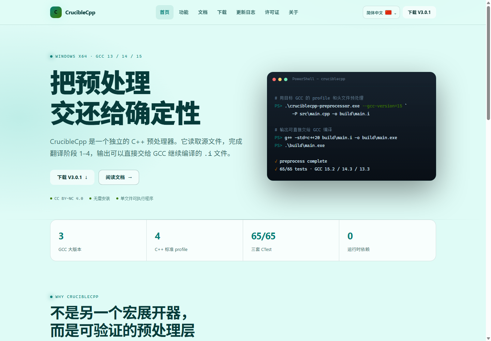
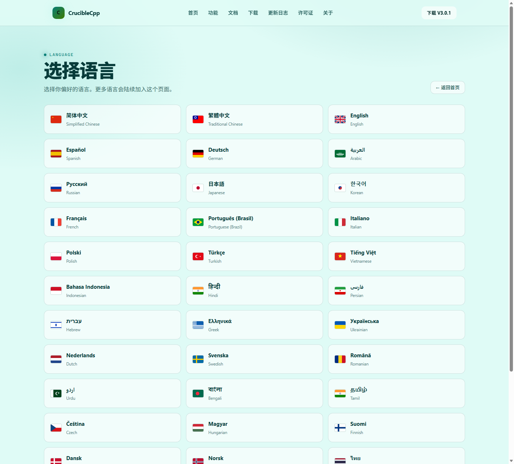

# CrucibleCpp Website

[](LICENSE)
[](https://hfsdr.cn)
[](languages.html)
[](https://github.com/tomatoOyster/cruciblecpp-website/releases)

Official desktop website for [CrucibleCpp Preprocessor](https://github.com/tomatoOyster/cruciblecpp-preprocessor).

CrucibleCpp is a standalone C++ preprocessor for Windows x64. It reads C++ source, performs translation phases 1–4, and emits `.i` output that a target GCC can compile directly.

This repository contains the complete **desktop** site: hand-written HTML, CSS and JavaScript, inline SVG flags, 33 language editions with exact structural parity against the Chinese source, and a sanitized Nginx example. There is no build step and no runtime dependency.

## Links

| | |
|---|---|
| Live site | https://hfsdr.cn |
| Language hub | https://hfsdr.cn/languages.html |
| Product | https://github.com/tomatoOyster/cruciblecpp-preprocessor |
| Product releases | https://github.com/tomatoOyster/cruciblecpp-preprocessor/releases |
| VS Code extension | https://github.com/tomatoOyster/cruciblecpp-vscode |

## Affiliated project

The official VS Code extension lives in a separate repository:

- [CrucibleCpp for VS Code](https://github.com/tomatoOyster/cruciblecpp-vscode)
- [Download VSIX](https://github.com/tomatoOyster/cruciblecpp-vscode/releases/latest)
- Entry page on this site: [`vscode.html`](vscode.html)

It preprocesses the current file, opens a read-only `.i` preview, publishes
diagnostics to Problems, saves `.i`, diffs against `g++ -E`, reads
`compile_commands.json`, and exposes GCC include paths.

## Screenshots

### Home



### Language hub



## What is in this repository

- The public home page and six content pages
- A dedicated language hub at `languages.html`
- 33 language entries with flags and localized pages
- RTL layout support for Arabic, Persian and Hebrew
- A custom language picker with keyboard interaction and outside-click close
- Section aliases such as `/en/docs.html` that open the translated section
- A static 404 page
- Responsive desktop layout
- Cyan light theme defined with CSS custom properties
- Sanitized Nginx example in `deploy/nginx.conf.example`

The mobile site is maintained separately and is **not** part of this repository.

## Pages

```text
index.html             Home / hero / quick product overview
features.html          Feature breakdown
docs.html              Quick start and target selection
download.html          V3.0.1 downloads, SHA-256, license boundary
changelog.html         Release history
license.html           License terms by version
about.html             Project scope and links
languages.html         Language hub
404.html               404 page
```

## Languages

The language hub currently lists 33 entries:

| Code | Language | Path |
|---|---|---|
| `zh-CN` | 简体中文 | `/` |
| `zh-TW` | 繁體中文 | `/zh-TW/` |
| `en` | English | `/en/` |
| `es` | Español | `/es/` |
| `de` | Deutsch | `/de/` |
| `ar` | العربية | `/ar/` |
| `ru` | Русский | `/ru/` |
| `ja` | 日本語 | `/ja/` |
| `ko` | 한국어 | `/ko/` |
| `fr` | Français | `/fr/` |
| `pt` | Português (Brasil) | `/pt/` |
| `it` | Italiano | `/it/` |
| `pl` | Polski | `/pl/` |
| `tr` | Türkçe | `/tr/` |
| `vi` | Tiếng Việt | `/vi/` |
| `id` | Bahasa Indonesia | `/id/` |
| `th` | ไทย | `/th/` |
| `hi` | हिन्दी | `/hi/` |
| `fa` | فارسی | `/fa/` |
| `he` | עברית | `/he/` |
| `el` | Ελληνικά | `/el/` |
| `uk` | Українська | `/uk/` |
| `nl` | Nederlands | `/nl/` |
| `sv` | Svenska | `/sv/` |
| `ro` | Română | `/ro/` |
| `ur` | اردو | `/ur/` |
| `bn` | বাংলা | `/bn/` |
| `ta` | தமிழ் | `/ta/` |
| `cs` | Čeština | `/cs/` |
| `hu` | Magyar | `/hu/` |
| `fi` | Suomi | `/fi/` |
| `da` | Dansk | `/da/` |
| `no` | Norsk | `/no/` |

Each locale directory contains:

```text
index.html             Full translated page
features.html          Section alias -> #features
docs.html              Section alias -> #docs
download.html          Section alias -> #download
changelog.html         Section alias -> #changelog
license.html           Section alias -> #license
about.html             Section alias -> #about
```

The aliases keep every localized URL working without duplicating the translated
content. The language dropdown stays short; new languages are added to
`languages.html` instead of growing the dropdown forever.

## Repository structure

```text
.
├── index.html
├── features.html
├── docs.html
├── download.html
├── changelog.html
├── license.html
├── about.html
├── languages.html
├── 404.html
├── robots.txt
├── sitemap.xml
├── LICENSE
├── README.md
├── CHANGELOG.md
├── assets/
│   ├── style.css
│   ├── app.js
│   ├── lang.js
│   ├── languages.css
│   ├── favicon.svg
│   └── screenshots/
│       ├── home.png
│       └── languages.png
├── deploy/
│   └── nginx.conf.example
├── en/
├── zh-TW/
├── es/
├── de/
├── ar/
├── ru/
├── ja/
├── ko/
├── fr/
├── pt/
├── it/
├── pl/
├── tr/
├── vi/
├── id/
├── th/
├── hi/
├── fa/
├── he/
├── el/
├── uk/
├── nl/
├── sv/
├── ur/
├── bn/
├── ta/
├── cs/
├── hu/
├── fi/
├── da/
├── no/
└── ro/
```

## Local preview

No package manager, bundler or build step is required.

### Python

```powershell
python -m http.server 8080
```

Open:

```text
http://localhost:8080/
```

### Node.js

```powershell
npx serve .
```

Do not open the HTML files directly with `file://` if you want to test
absolute paths such as `/en/` and `/languages.html`.

## Deployment

The site is plain static output. Copy the repository contents to a web root,
for example:

```sh
rsync -av --delete \
  --exclude '.git' \
  --exclude 'deploy' \
  ./ user@example.com:/var/www/cruciblecpp-website/
```

A sanitized Nginx configuration is included:

```text
deploy/nginx.conf.example
```

It shows:

- `try_files` for clean static routing
- a custom `404.html`
- long-lived caching for CSS, JS and SVG
- basic security headers

Replace the example domain and certificate paths before using it. Never commit
TLS private keys, passwords, API tokens, or server-specific credentials.

## Adding a language

1. Add a new locale directory with:

   ```text
   index.html
   features.html
   docs.html
   download.html
   changelog.html
   license.html
   about.html
   ```

2. Add the language card to `languages.html`.
3. Add the locale to the sitemap if it should be indexed.
4. Add the language to the navigation or language hub as appropriate.
5. Verify every route returns HTTP 200.
6. If the language is RTL, use `<html lang="..." dir="rtl">`.
7. Check that code blocks remain LTR.
8. Check flags and language names at 1440 px and 1024 px.

Section aliases should point at the translated page:

```html
<meta http-equiv="refresh" content="0; url=index.html#docs">
<script>location.replace('index.html#docs');</script>
```

## Design notes

The site uses a light cyan visual system. The main tokens live in
`assets/style.css`:

```css
--bg: #dffbf6;
--text: #073b3a;
--accent: #087f78;
```

The language picker is intentionally custom:

- a visible button with flag, language name and chevron
- a listbox with flag + language for each entry
- `Escape` closes the list
- arrow keys move through entries
- clicking outside closes the list
- the final entry opens `languages.html`

The top dropdown keeps the nine primary languages. New languages go to the
language hub so the dropdown does not grow without limit.

## Validation

The current site has been checked with:

- every locale route returning HTTP 200
- 33 language cards on `languages.html`
- RTL rendering for Arabic, Persian and Hebrew
- the language menu opening and navigating correctly
- desktop screenshots at 1440 px
- no mobile files in this repository

## Contributing

Issues and pull requests are welcome.

For translation fixes:

- keep code blocks, commands, file names and URLs unchanged
- preserve the `#features`, `#docs`, `#download`, `#changelog`, `#license` and
  `#about` anchors
- do not rename existing locale directories
- keep the layout direction correct for RTL languages

For layout fixes:

- test at 1440 px and 1024 px
- test the language hub and at least one RTL locale
- avoid adding external runtime dependencies unless necessary

## License

MIT. See [LICENSE](LICENSE).

The CrucibleCpp product itself has a different license history:

- V3.0.0 and later: CC BY-NC 4.0
- V2.9.0 and earlier: MIT

This repository's MIT license applies to the website source.
